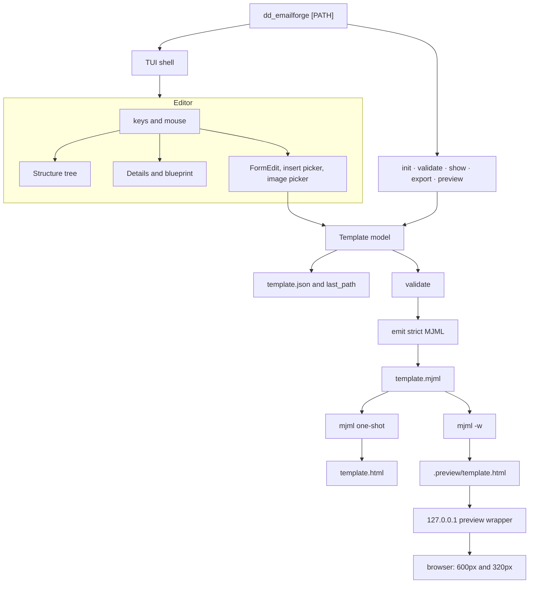

# dd_emailforge

Terminal-UI email template builder. Edit a typed `template.json`, export strict MJML, and compile HTML with official **MJML 5**. JSON is the source of truth. The binary does not render HTML itself.

**Tutorial (setup, install, TUI, screenshots):** [ldnddev.github.io/dd_emailforge](https://ldnddev.github.io/dd_emailforge/)

Current release: **0.9.7**.

## Install

```bash
curl -fsSL https://raw.githubusercontent.com/ldnddev/dd_emailforge/main/install.sh | bash
```

That detects OS/arch, downloads the matching GitHub Release (`linux`/`darwin` × `x86_64`/`aarch64`), checks the published sha256, and installs `$HOME/.local/bin/dd_emailforge`. Theme → `$HOME/.config/ldnddev/` (an existing theme is left alone). Pin a version with `VERSION=v0.9.7`. Uninstall: pipe the same script with `bash -s -- uninstall`.

From a clone (builds with cargo):

```bash
./install.sh
./install.sh --from-release   # use the GitHub package even from a clone
./install.sh uninstall
```

Honors `PREFIX`, `BIN_DIR`, `CONFIG_DIR`, `XDG_CONFIG_HOME`. MJML 5 needs **Node 20+**. `init` pins `mjml ^5.4.0` in `package.json` but does not run `npm install`. Skip that step if `mjml` is already on your PATH.

## Quick start

```bash
dd_emailforge init ./my-email --from welcome
# only if mjml is not already on PATH:
cd my-email && npm install
dd_emailforge ./my-email
```

`dd_emailforge` is the app: a path, or bare (reopens the last template). `n` New and `o` Open work inside it. A directory argument means `dir/template.json`. Starters: `welcome` (default) · `newsletter` · `promo` · `transactional`.

Optional CLI tools, same binary:

| Command | What it does |
|---|---|
| `init <dir>` | Create `template.json`, `images/`, `package.json`, `.gitignore` |
| `validate <path>` | Structural and image checks. Errors exit 1 |
| `show <path>` | Pretty-print the loaded template (unknown JSON keys are dropped) |
| `export <path>` | Validate, write `template.mjml` + `template.html` |
| `preview <path>` | `mjml -w` plus a loopback wrapper on port **8766** |

Quit is **Ctrl+Q** only. Full keys, preview, and export: the [tutorial](https://ldnddev.github.io/dd_emailforge/) and `F1` in the TUI.

Images live in `images/`. A bare name such as `logo.png` means `images/logo.png`. Export joins that path to an `https://` `base_url`. Preview rewrites it to `http://127.0.0.1:{port}/images/…`. The preview server binds loopback only and will not follow a symlink outside the template.

## How the app is put together



`Shift+E` validates, writes MJML, and compiles off the UI thread. `p` starts `mjml -w` and opens the browser immediately; the wrapper shows `compiling…` until the HTML file appears. Autosave rewrites `template.json` after 2 seconds. Manual `s` also writes `template.json.backup`. FormEdit save, undo, and redo refresh `template.mjml` right away so a running preview updates.

The compiler is the `mjml` binary in `{template}/node_modules/.bin` when that file exists, otherwise `mjml` on `PATH`. Includes are off. Validation level is strict.

## Folder structure

```mermaid
flowchart TD
  root["dd_emailforge/"]

  root --> cargo["Cargo.toml · Cargo.lock"]
  root --> install["install.sh"]
  root --> license["LICENSE"]
  root --> themeFile["dd_emailforge_theme.yml"]
  root --> arch["Architecture.md"]
  root --> visual["LDNDDEV_TUI_VISUAL_STANDARD.md"]
  root --> readme["README.md"]

  root --> gh[".github/"]
  gh --> workflows["workflows/pages.yml · release.yml"]
  gh --> dependabot["dependabot.yml"]

  root --> components["components/"]
  components --> contracts["25 field contracts, one Markdown file per block"]

  root --> docs["docs/"]
  docs --> index["index.html — GitHub Pages tutorial"]
  docs --> spec["SPEC.md · DESIGN.md · README.md"]
  docs --> capture["capture.sh · .nojekyll"]
  docs --> images["images/ — tutorial PNGs"]

  root --> src["src/"]
  src --> main["main.rs — clap"]
  src --> model["model.rs"]
  src --> storage["storage.rs · paths.rs"]
  src --> validate["validate.rs"]
  src --> emit["emit.rs · border.rs · padding.rs"]
  src --> mjml["mjml.rs"]
  src --> preview["preview.rs"]
  src --> starters["starters.rs"]

  src --> tui["tui/"]
  tui --> shell["mod.rs · draw.rs · events.rs · theme.rs · toasts.rs · help.rs"]
  tui --> document["tree.rs · details.rs · cursor.rs · edits.rs · session.rs"]
  tui --> editing["editform/ · modals/ · insert.rs · form_textarea.rs · component_kind.rs"]
  tui --> output["export.rs · util.rs · column_widths.rs"]
  tui --> shotTests["tests.rs · tutorial_shots.rs — cfg test"]

  root --> crate["crates/ldnddev_theme/"]
  crate --> themeSrc["src/: palette, yaml, editor, paths, rgb, fields"]
  crate --> themeTests["tests/theme.rs · LICENSE · README.md"]
```



`target/` is cargo output and is gitignored. A template folder you create with `init` is not part of this repo. It holds `template.json`, `images/`, `package.json`, and, after export or preview, `template.mjml`, `template.html`, and `.preview/`.

## Docs

- [Tutorial](https://ldnddev.github.io/dd_emailforge/) — setup, screenshots, how to recapture them (`docs/index.html`)
- `Architecture.md` — crate map and pipeline
- `docs/SPEC.md` — living conventions
- `docs/DESIGN.md` — locked design
- `components/*.md` — field contracts
- `LDNDDEV_TUI_VISUAL_STANDARD.md` — theme tokens

```bash
cargo test -q
```

Compiler-backed tests are `#[ignore]` (`cargo test -- --ignored`; needs `mjml` on PATH).

## License

MIT License.
